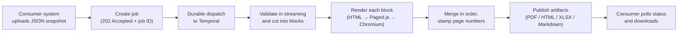
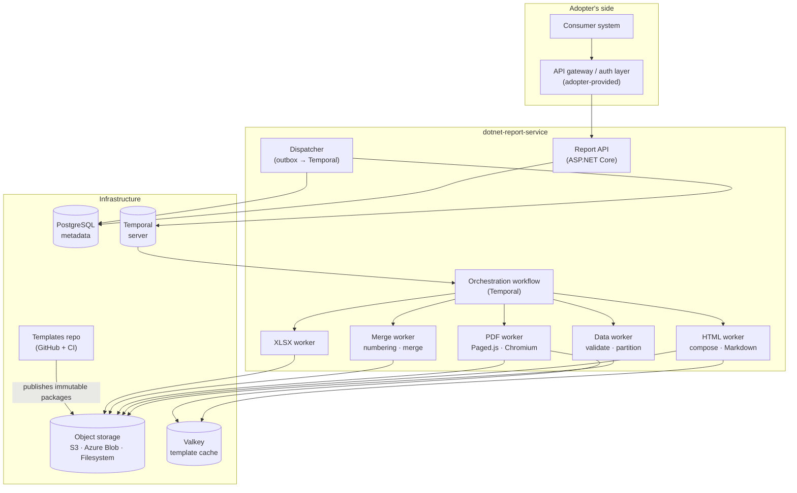
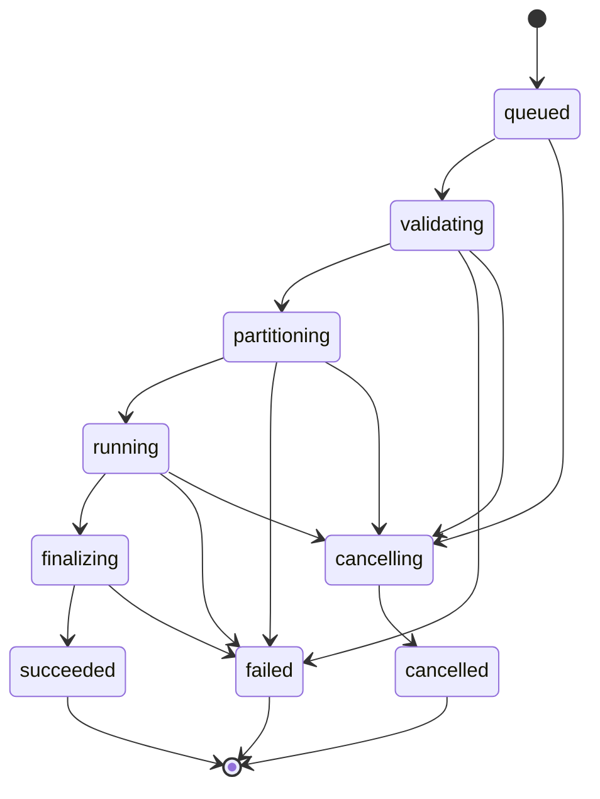

# dotnet-report-service

A self-hosted, open-source **report generation service** for .NET. It turns one
immutable JSON snapshot plus one versioned template into downloadable **PDF,
HTML, Excel and Markdown** files — durably, asynchronously, and with memory
that stays bounded no matter how large the report is.

> **Version: 0.2.0 — in progress** (builds report `0.2.0-dev`; not released
> yet). Latest release: **0.1.0** (2026-10-22). See [CHANGELOG.md](CHANGELOG.md).
>
> **Project status: groundwork released, product implementation not started.**
> Release 0.1.0 completes the first milestone of the [roadmap](#roadmap)
> (Stage 0): the solution skeleton with a local development composition
> started by one command, the PDF base image, seeded pilot datasets with
> sample templates, and five measured spikes under [`spikes/`](spikes/) —
> streaming data and template engines, PDF layout, PDF assembly, XLSX
> writing and Markdown conversion. The spikes record measurements, not
> decisions: the remaining library choices are made from them next. No
> report is rendered yet — the API answers health checks only and the render
> worker only checks that Chromium starts; the rest of this README
> describes what is being built and why. The design and analysis documents
> live in the companion repository
> [dotnet-report-service-sdlc](https://github.com/EugenioSerrano/dotnet-report-service-sdlc).

---

## Table of contents

1. [Why this exists](#why-this-exists)
2. [What it guarantees](#what-it-guarantees)
3. [How a report is produced](#how-a-report-is-produced)
4. [Architecture](#architecture)
5. [The data contract](#the-data-contract)
6. [Templates](#templates)
7. [Outputs](#outputs)
8. [The API](#the-api)
9. [Job lifecycle and status](#job-lifecycle-and-status)
10. [Security model — read this before deploying](#security-model--read-this-before-deploying)
11. [Configuration you must provide](#configuration-you-must-provide)
12. [What it is not](#what-it-is-not)
13. [Roadmap](#roadmap)
14. [Technology decisions](#technology-decisions)
15. [Development](#development)
16. [Contributing and licence](#contributing-and-licence)

---

## Why this exists

Business systems need documents: monthly statements, invoices with hundreds of
lines, audit lists with thousands of pages. The usual approach — render the
document inside the business system's own API — breaks as soon as the report
gets large:

- the request times out and nobody knows whether the file was produced;
- the process loads the whole dataset to lay it out and runs out of memory;
- a restart halfway loses the work, or does it twice;
- "subtotal of this page" is computed from an *estimate* of rows per page and
  no longer matches what was printed.

`dotnet-report-service` takes that work out of the business system. The
consumer uploads its data once, creates a job, gets an ID back immediately,
and downloads the files when they are ready — even if it closed the screen,
even if a worker crashed in the middle.

## What it guarantees

| Guarantee | What it means in practice |
|-----------|---------------------------|
| **Bounded memory** | No component ever loads, deserialises or retains the whole input JSON. Data is read sequentially, cut into bounded *blocks* (~1 000 records), and each block is rendered on its own. Memory is a function of configured limits, not of dataset size. |
| **Durability** | An accepted job is persisted together with a durable "start this" intent before the API answers. Workflows run on [Temporal](https://temporal.io); restarts and transient failures retry from the last committed block without losing or duplicating pages or outputs. |
| **Accounting-grade pagination** | Page subtotals, group subtotals, carried-forward totals and "Page X of Y" are computed on the rows that *actually* landed on each page after layout, with decimal arithmetic — never estimated. |
| **Reproducibility** | A job is pinned to an immutable template package (ID + version + package hash + commit SHA), a fixed snapshot hash, a fixed culture, time zone and *report clock*. Re-running produces the same document; changing the template repository afterwards changes nothing. |
| **Templates as code** | Templates live in a Git repository, are validated by CI and published as immutable versions. The render path never reads GitHub. |
| **One snapshot, many formats** | PDF, HTML, XLSX and Markdown come from the same data and the same template; only the requested renderers run. |

## How a report is produced



Step by step:

1. **Upload.** The consumer opens an upload session and streams the JSON —
   either directly to object storage through a temporary signed URL, or
   through the API. On confirmation the service verifies size and SHA-256 and
   fixes an **immutable snapshot**.
2. **Create the job.** One request names the snapshot, the template ID and
   exact version, the output formats and the render settings (culture, time
   zone). The job and its submission intent are written in a single local
   transaction; the API answers `202 Accepted`. An `Idempotency-Key` makes
   retries safe: same key + same request → same job; same key + different
   request → `409`.
3. **Dispatch.** A dispatcher reads pending intents and starts a Temporal
   workflow with a stable ID derived from the job, so a repeated dispatch never
   creates a second execution.
4. **Validate and partition.** A data worker reads the snapshot front to back
   with an incremental parser, validates header and records against the
   template's schema, computes aggregates and opening running totals, and
   writes **blocks** (cut by record count or bytes, preferring group
   boundaries) plus a durable block index. A late error anywhere in the file
   fails the job; nothing partial is ever announced as success.
5. **Render.** For PDF, each block becomes HTML through the template engine,
   is laid out by Paged.js in an isolated headless Chromium context, and the
   page subtotals are computed on the real row distribution. Blocks render in
   parallel within a bounded window. HTML, XLSX and Markdown have their own
   workers; an HTML-only job never starts Chromium.
6. **Assemble and publish.** Partial PDFs are merged in block order, global
   page numbers are stamped into a reserved area, counts and hashes are
   verified, and each artifact is committed only when complete. A late attempt
   never overwrites a result and never publishes after a cancellation.
7. **Download.** The consumer polls the job, sees per-output status and
   monotonic counters (never an invented percentage), and downloads each file
   by stream or temporary URL until it expires.

## Architecture



| Part | Responsibility | Notes |
|------|----------------|-------|
| **Report API** | Uploads, jobs, status, artifacts, template metadata | Never renders; never holds a request open for a render; streams bytes, never buffers files in memory |
| **Metadata database** (PostgreSQL) | Jobs, inputs, template references, outputs, artifacts, block-index references, submission intents | Accessed with Dapper and explicit SQL; separate database/user from Temporal's own tables; never stores datasets, HTML, PDFs or unbounded lists |
| **Dispatcher** | Reads pending submission intents and starts workflows | Outbox pattern — closes the gap between the database and Temporal without an extra broker |
| **Temporal** | Durable, deterministic orchestration of each job | Workflows exchange only references and small metadata; activities do the I/O |
| **Workers** | One task queue per cost type: `report-data`, `report-html`, `report-pdf-rendering`, `report-pdf-merge`, `report-xlsx` | PDF workers run one Chromium each and scale independently; light workers may share a process |
| **Object storage** | Snapshots, blocks, intermediates, outputs, published template packages | Injectable providers: S3-compatible, Azure Blob Storage, Filesystem (the local/dev default). Each provider declares its capabilities (signed URLs, conditional commit) |
| **Valkey** (Redis protocol) | Shared cache of template packages and metadata across workers | A cache miss or outage never blocks rendering: object storage is the source of truth. Adopters may run Redis instead |
| **Templates repository** | Source of templates; CI validates and publishes immutable packages | GitHub is the *source*, never a runtime dependency |

Observability is OpenTelemetry-based (logs, traces, metrics per job, block,
format and attempt); the .NET Aspire dashboard is the local starting point.
Health checks distinguish *alive*, *ready* and *connected* without rendering a
PDF on every probe.

## The data contract

The first (and, for the MVP, only) data profile is **`header-items-v1`**: a
UTF-8 JSON object with a small `header` that physically precedes an `items`
array.

```json
{
  "contractVersion": "1.0",
  "header": {
    "reportTitle": "Billing detail",
    "generatedAt": "2026-10-19T23:35:00Z",
    "currency": "ARS",
    "customer": { "id": "C001", "name": "Example customer" },
    "totals": { "amount": 3200.50 }
  },
  "items": [
    { "sequence": 1, "groupId": "energy", "description": "Consumption", "amount": 2200.50 },
    { "sequence": 2, "groupId": "energy", "description": "Fixed charge", "amount": 1000.00 }
  ]
}
```

Rules of the profile:

- `header` comes before `items`; both the header and each record have size
  limits, as do token length and nesting depth.
- Records arrive **in final order**. Global sorting, joins and lookups are the
  producer's job; the template only presents.
- Records of a group are **contiguous**, so group subtotals need no auxiliary
  storage.
- `sequence` is optional; the service assigns a stable technical ordinal.
- Grand totals are precalculated in the header or computed by a sequential
  pre-pass — never by a global loop inside a template.
- Truncated documents, type mismatches, duplicated technical properties and
  trailing content are detected and fail the job.

Planned additional profiles: root array (for raw XLSX), NDJSON, and objects
with several first-level arrays (one sheet each).

## Templates

A template is a **package**: a folder in the templates repository that CI
turns into an immutable, versioned artifact.

```text
templates/
  invoice-energy/
    template.yaml        # manifest: engine, data contract, outputs, page settings
    schema.json          # JSON schema of the input
    sample.json          # sample data used by CI to render a preview
    html/
      document-start.html.sbn
      row.html.sbn
      group-start.html.sbn
      group-end.html.sbn
      document-end.html.sbn
      styles.css
      partials/
    assets/
      logo.png
      fonts/
    excel/
      report.xlsx        # optional Excel template (later milestone)
```

**Engines.** Templates are written in **Scriban, Handlebars or Liquid
(Fluid)** — the three ship in the MVP as peers; **there is no default engine**.
The manifest declares which one the package uses (`engine:`). Razor is
reserved for a later version, once an isolation model exists. Switching
engine means publishing a new version; there is no automatic syntax
conversion.

**Rendering context.** A template sees only `header`, `item`, `group`,
`block`, `aggregates` and `render` (culture, time zone, report clock). It
cannot loop over the whole collection, reach the host file system, cloud
metadata or the internal network, and it can only load assets packaged with
it.

**Publishing — "edit, commit, done".** Authors work in their editor, bump
`version` in `template.yaml` and push to the publication branch. CI validates
the manifest, schema, sample, syntax, includes and assets, renders a sample
HTML/PDF, and publishes the package to object storage with its version, commit
SHA and hash. No pull request is mandatory (a repository may require one by its
own policy). Republishing an existing version with different bytes is
rejected: bump the version. A new version takes effect only for the jobs that
reference it — consumers pin exact versions, so nothing changes under their
feet.

**Ownership.** Every package belongs to a consumer and may be flagged
`shared`; a consumer can render its own packages and the shared ones.

**Pagination settings** live in the manifest: paper size, orientation,
margins, repeated table headers, declared sections and page breaks, page
totals (`amountField`, `scale`). Large reports use **page-boundary** layout:
every block starts on a new page, and blocks are cut at group or section
boundaries whenever possible so the breaks look natural.

## Outputs

| Format | How it is produced | Notes |
|--------|--------------------|-------|
| **PDF** | HTML per block → Paged.js → headless Chromium (Playwright) → partial PDFs merged in order, page numbers stamped | Page subtotals on the real row distribution. A row that spans two pages is counted once, on the page where it **ends**, with a "continues" mark on the first page. |
| **HTML** | The semantic HTML before Paged.js, assembled sequentially (header, fragments, footer) | Single self-contained file, or a package with its assets. Produced without starting Chromium. |
| **XLSX** | *Raw* export straight from the JSON when the package has no Excel template; *template* export (later milestone) when it has one | Root array → sheet `Data`; nested objects → `customer.name` column paths; header metadata → `Metadata` sheet. Types follow the schema: identifiers and leading zeros stay text; a numeric value Excel cannot hold exactly (15 significant digits) **fails the export** rather than being rounded silently; formula-like strings are always text. Excel limits (1 048 576 rows, 16 384 columns, 32 767 characters per cell) are never exceeded by truncation. A built-in shared `generic-raw` package lets XLSX-only jobs export without publishing a template. |
| **Markdown** | Converted from the semantic HTML, fragment by fragment | Keeps headings, paragraphs, lists, tables, links and images; loses CSS, positioning, typography, physical headers/footers and page breaks — by design. |

E-mail delivery, physical printing and a visual designer are **not** outputs
of this service (see [What it is not](#what-it-is-not)).

## The API

All routes are versioned under `/api/v1`. Errors use RFC 7807 Problem Details
with a stable `code`.

| Method and route | Purpose |
|------------------|---------|
| `POST /uploads` | Open an upload session; returns an ID and, when the storage provider supports it, a temporary signed destination |
| `PUT /uploads/{uploadId}/content` | Stream the JSON through the API (always available) |
| `POST /uploads/{uploadId}/complete` | Confirm the upload; verification may be asynchronous |
| `GET /uploads/{uploadId}` | Verification status |
| `POST /report-jobs` | Create a job (`202 Accepted`); supports `Idempotency-Key` |
| `GET /report-jobs/{reportJobId}` | Status, stage, counters, per-output status, warnings |
| `POST /report-jobs/{reportJobId}/cancel` | Cooperative cancellation |
| `GET /report-jobs/{reportJobId}/artifacts` | List downloadable artifacts |
| `GET /report-jobs/{reportJobId}/artifacts/{artifactId}/download` | Stream or temporary redirect |
| `GET /templates/{templateId}/versions/{version}` | Published metadata and capabilities of a template version |

Create a job:

```json
{
  "template": { "id": "invoice-energy", "version": "1.0.0" },
  "data": { "uploadId": "upload-example-001", "profile": "header-items-v1" },
  "outputs": ["html", "pdf", "xlsx", "markdown"],
  "render": { "culture": "es-AR", "timeZone": "America/Argentina/Buenos_Aires" },
  "metadata": { "externalReference": "billing-2026-10" }
}
```

Response:

```json
{ "reportJobId": "job-example-001", "status": "queued", "statusUrl": "/api/v1/report-jobs/job-example-001" }
```

Status while running:

```json
{
  "reportJobId": "job-example-001",
  "status": "running",
  "stage": "rendering-pdf",
  "progress": { "recordsRead": 50000, "recordsTotal": null, "blocksCompleted": 20, "blocksTotal": 50, "pagesGenerated": 380 },
  "outputs": [
    { "format": "pdf",  "status": "running",   "artifactId": null },
    { "format": "xlsx", "status": "succeeded", "artifactId": "artifact-example-xlsx" }
  ],
  "warnings": []
}
```

Stable error codes: `TEMPLATE_NOT_FOUND`, `TEMPLATE_VERSION_CONFLICT`,
`TEMPLATE_INVALID`, `DATA_INVALID`, `RECORD_TOO_LARGE`, `QUOTA_EXCEEDED`,
`UNSUPPORTED_CAPABILITY`, `PAGINATION_FAILED`, `RENDER_TIMEOUT`,
`ARTIFACT_INTEGRITY_FAILED`, `OUTPUT_LIMIT_EXCEEDED`, `IDEMPOTENCY_CONFLICT`,
`JOB_CANCELLED`.

## Job lifecycle and status



- A job is `succeeded` only when **every** requested output succeeded. If one
  output fails definitively the job is `failed`, each output keeps its own
  visible status, and the artifacts already published stay downloadable.
- Each output has its own status: `pending`, `running`, `succeeded`, `failed`,
  `cancelled`.
- Artifacts **expire** according to retention; expiry never changes the job's
  status — a succeeded job stays succeeded.
- Counters are monotonic. No percentage is reported unless the total is known.
- An HTTP timeout or a dropped connection never cancels a job; only
  `POST …/cancel` does, cooperatively, and nothing is published after it.

## Security model — read this before deploying

**The service ships without authentication.** Every request carries a
*declared* `consumerId`, and the service trusts it. Ownership of uploads, jobs,
artifacts and template packages, idempotency scope and quotas are all applied
to that declared identity.

This is a deliberate choice for an open-source component that each adopter
customises: **you must put the API behind your own API gateway, network
isolation or authentication layer**, and inject the authenticated consumer
identity. Exposed directly, anyone who reaches the API can act as any
consumer. A pluggable authentication mechanism is a candidate for a later
version.

What the service does enforce:

- a request without a registered `consumerId` is rejected; another consumer's
  resources are never revealed (404, not 403);
- templates cannot reach host files, cloud metadata endpoints or the internal
  network; only packaged assets load;
- browser contexts are isolated per job and cleaned between jobs;
- datasets, signed URLs and secrets are never written to logs;
- error responses contain no stack traces or internal paths.

Retention, purge-on-demand, download auditing and encryption at rest are the
adopter's responsibility in the first versions (see
[Configuration](#configuration-you-must-provide)); purge and audit features
are planned after the MVP.

## Configuration you must provide

- **Retention periods** for incomplete uploads, snapshots, intermediate blocks,
  outputs and metadata. The service **refuses to start in production without
  them**; the development profile ships short example values.
- **A storage provider**: S3-compatible, Azure Blob Storage or Filesystem.
  Direct-to-storage uploads and temporary download URLs require a provider
  with signed URLs; the Filesystem provider supports API streaming only.
- **Limits and quotas**: maximum header and record size, block size, JSON
  depth, render timeout per block, concurrent blocks per job, PDF renders per
  worker. The shipped defaults are starting hypotheses (1 MiB header and
  record, 1 000 records or 8 MiB per block, 16 MiB hard maximum, 64 levels,
  5-minute block timeout, 2 concurrent blocks, 1 render per PDF worker);
  measure before relying on them.
- **PostgreSQL**, **Temporal** and **Valkey** (or Redis) connection settings.

The service publishes measured capacity figures per release on reference
datasets. It commits to **no SLA**.

## What it is not

- **Not a visual report designer or an admin portal.** Templates are code; the
  issuing screen belongs to the consumer system.
- **Not a business-logic engine.** Calculations, sorting, joins and totals
  arrive in the JSON; templates present.
- **Not a printing system.** No drivers, spoolers or printer protocols — it
  produces printable documents.
- **Not a "load everything and render" converter.** Bounded memory is the
  non-negotiable constraint, not an optimisation.
- **Not a fiscal document issuer.** It does not sign, stamp or register
  documents with any tax authority.
- **Not a sandbox for untrusted end-user templates.** Templates are technical,
  reviewed artifacts.
- **No PDF/A or PDF/UA conformance claim.** Adopters post-process if they need
  it.

## Roadmap

| Milestone | Delivers |
|-----------|----------|
| **Stage 0 — spikes** | Solution skeleton and Aspire AppHost; LTS-first version matrix; measured spikes for the incremental parser, template engines per record, Paged.js + Chromium on Linux (vs. native `@page` margin boxes), page subtotals, global numbering, PDF merge (PDFsharp vs. qpdf), XLSX writer (MiniExcel vs. Open XML SDK), Markdown conversion routes; seeded synthetic pilot datasets |
| **MVP — first durable path** | Upload sessions, idempotent job creation, durable dispatch to Temporal, immutable template packages with the three engines, separate PDF worker, status and download, restart resilience, observability baseline, Filesystem storage provider — for a small single-block report |
| **v1 — first operational version** | Streaming validation, partitioning and durable block index, bounded concurrency and ordered merge, page/group/carried-forward totals, global numbering, cancellation, HTML / raw XLSX / Markdown outputs, per-output status, retention and cleanup, authorization on the declared consumer, S3 and Azure Blob providers, Valkey cache, measured limits, OpenAPI and runbooks, local Kubernetes test |
| **v2 — extensions** | Excel template rendering, Razor with an isolation model, webhooks, administrative capabilities, autoscaling; candidates: pluggable authentication, purge-on-demand and download audit |
| **Backlog** | E-mail delivery, own Markdown templates, continuous layout across blocks, advanced Excel, broker integration, cross-references with page numbers, inline small-data shortcut |

### Versioning

The product follows [Semantic Versioning](https://semver.org/) with a single
version for the whole repository. It stays at **0.y.z** while the milestones
above are delivered — no API or contract stability is promised until then —
and the first operational version ships as **1.0.0**. Every release is listed
in [CHANGELOG.md](CHANGELOG.md) and tagged `vX.Y.Z`.

Between releases, builds carry a `-dev` pre-release label (currently
`0.2.0-dev`; the latest release is `0.1.0`). A version is released when the
maintainer declares it: the label is removed, the changelog gets the dated
version section, `develop` is merged into `main`, and `main` is tagged
`vX.Y.Z`. `main` always holds the latest release; `develop` holds the work in
progress.

## Technology decisions

| Area | Decision |
|------|----------|
| Platform | .NET 10 (LTS, supported until November 2028; SDK pinned in `global.json`) on Linux containers; Aspire 13.6 for local development; Kubernetes or Azure Container Apps for production |
| Orchestration | Temporal (self-hosted) with PostgreSQL 18; local development uses the official Temporal CLI dev-server image |
| Metadata | PostgreSQL, accessed with Dapper and explicit SQL |
| PDF | Playwright 1.63 + headless Chromium 153 baked into the worker image; Paged.js 0.4.3 for pagination (native Chromium `@page` margin boxes evaluated in Stage 0) |
| Template engines | Scriban, Handlebars.Net, Fluid (Liquid) — peers, no default; Razor later |
| Object storage | Injectable providers: S3-compatible, Azure Blob Storage, Filesystem |
| Cache | Valkey 9.1 for template packages (Redis protocol — Redis works as well) |
| PDF merge / stamping, XLSX writer, Markdown | Chosen after the Stage 0 spikes; candidates are permissive-licensed only (PDFsharp, qpdf, MiniExcel, Open XML SDK, ReverseMarkdown) |
| Chunk layout | `page-boundary` with group/section-boundary cuts; continuous layout is backlog |

Every runtime dependency is pinned and shipped in the images; nothing is
downloaded from the internet during a job.

## Development

### Prerequisites

- The **.NET 10 SDK**, 10.0.402 or a later 10.0.4xx patch (see `global.json`).
- **Docker with Linux containers and BuildKit (the buildx plugin)**, reachable
  by the `docker` command (Docker Desktop, Rancher Desktop or Docker Engine
  with buildx) — only needed to run the local composition, whose first run
  builds the PDF base image from a Dockerfile; building the solution needs
  neither.
- The loopback port **`127.0.0.1:5055` free** for the local development
  registry the composition uses.
- **On Windows, a short clone path or long-path support.** The browser
  automation package copies driver files into the render worker's build
  output whose paths exceed the 260-character limit under deep clone paths.
  Clone near the drive root (for example `C:\src\dotnet-report-service`), or
  enable the Windows long-path setting and run `git config core.longpaths true`.

### Build

```bash
dotnet build dotnet-report-service.slnx
```

Warnings are errors and code style is enforced, so a clean build has no
warnings.

### Run the local composition

```bash
dotnet run --project src/ReportService.AppHost
```

Before any resource starts, the command prepares the render worker image:

1. it makes sure the local development registry container
   `report-service-dev-registry` is running — the pinned `registry` image,
   published on `127.0.0.1:5055` only, so it is reachable from this machine
   and nowhere else;
2. if the PDF base image (the ASP.NET Core runtime plus the Chromium headless
   shell, defined in [`eng/pdf-base/`](eng/pdf-base/)) is not in that registry
   yet, it builds it with BuildKit and stores it there — **first run only**,
   a few minutes;
3. it publishes the render worker image with the .NET SDK on that base, by
   the digest the registry reports (about 20 seconds), into the local
   container runtime.

If one of these steps fails, the command stops with the failing step's
output before any resource starts. It then starts, on the local machine only:

- `api` — the API (for now a stub with `/health`, on `http://localhost:5080`);
- `postgres` — PostgreSQL 18 with the `reportservice` database;
- `cache` — Valkey 9.1;
- `temporal` — the Temporal development server (gRPC on 7233, web UI on 8233
  inside the container);
- `render-worker` — the PDF render worker container, built by the .NET SDK on
  a base image with the Chromium headless shell.

The console prints the dashboard URL (with its login link); the dashboard
shows every resource, its health and its logs. The API starts only when the
other resources are healthy, so `http://localhost:5080/health` answering
`Healthy` means the whole composition is up. To see every resource state
change in the console as well, run:

```bash
dotnet run --project src/ReportService.AppHost -- --Logging:LogLevel:Aspire.Hosting=Debug
```

Stopping the command (Ctrl+C) removes the containers of the composition and
their data. The registry container is not part of the composition: it stays,
stopped or running, with the PDF base image in it, so later starts skip the
base build. The base is built only when its tag is missing from the registry,
so after a change to its definition (`eng/pdf-base/`) either give it a new
tag (`PdfBaseImageTag` in the render worker's project file) or remove the
registry container by name, which also discards the stored base:

```bash
docker rm -f report-service-dev-registry
```

The render worker image can also be published by hand, with the digest of
the base in the registry:

```bash
dotnet publish src/ReportService.Workers.Pdf -c Release -t:PublishContainer -p:PdfBaseImageDigest=sha256:<digest>
```

(spelled `-t:`, which every shell passes unchanged).

### Pilot datasets and sample templates

```bash
dotnet run --project samples/datasets/ReportService.Samples.DatasetGenerator -c Release -- generate
dotnet run --project samples/datasets/ReportService.Samples.DatasetGenerator -c Release -- verify
```

`generate` writes the three seeded pilot datasets (simple, grouped, 1 000 000
records) into `samples/datasets/`; `verify` checks that they are reproduced
byte for byte and match `samples/datasets/SHA256SUMS`. See
[`samples/datasets/README.md`](samples/datasets/README.md) for the datasets,
options and hashes, [`samples/templates/README.md`](samples/templates/README.md)
for the sample template packages, and
[`docs/reference-environment.md`](docs/reference-environment.md) for the
environment every published measurement runs on and how measurements are
reported.

### Layout


```text
dotnet-report-service/
├── src/                       Product source — src/ReportService.<Area>/
├── tests/                     Tests mirroring src/ (ReportService.<Area>.Tests)
│                              + IntegrationTests, RenderingTests, PerformanceTests
├── samples/                   Templates and seeded datasets for adopters
├── docs/                      Documentation
├── eng/                       Build and engineering assets
├── spikes/                    Stage 0 experiments — not part of the product
├── dotnet-report-service.slnx Product solution
├── global.json                .NET SDK pin (10.0.4xx band)
├── Directory.Build.props      Shared build settings (net10.0, warnings as errors, code style) and product version
├── Directory.Packages.props   Central package versions
├── NuGet.config               nuget.org only, with package source mapping
└── CHANGELOG.md               Release history
```

Naming rules, the shared configuration and the conventions this layout
follows are described in [`docs/repository-layout.md`](docs/repository-layout.md);
each folder has its own `README.md`.

Planned product projects under `src/`: `AppHost`, `ServiceDefaults`, `Api`,
`Contracts`, `Application`, `Domain`, `Infrastructure` (storage providers,
Dapper, cache), `Templates.Abstractions`, `Templates.Scriban`,
`Templates.Handlebars`, `Templates.Liquid`, `Workflows` (Temporal), and the
workers `Workers.Data`, `Workers.Html`, `Workers.Pdf`, `Workers.Merge`,
`Workers.Excel` — each prefixed `ReportService.`.

## Contributing and licence

Every change to this project traces back to a documented requirement, a
specification and a reviewed implementation record. The design and analysis
— vision, scope, domain model, processes, decisions and risks — are public in
the companion repository
[dotnet-report-service-sdlc](https://github.com/EugenioSerrano/dotnet-report-service-sdlc),
the best place to understand *why* things are the way they are before
proposing a change.

Licensed under the [MIT License](LICENSE). Third-party components keep their
own licences; a notice file accompanies each release.
