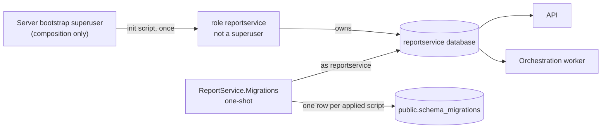

# The metadata database

The service keeps its own records — jobs, intents, template references, outputs,
artifacts — in a PostgreSQL database of its own. This page explains the database
and its role, the journal that records its schema, how a change adds a migration,
and how an operator provisions the database and applies migrations to an existing
deployment.



## The database and its role

| Element | Value |
|---------|-------|
| Database | `reportservice` |
| Role | `reportservice` — a login role that is **not** a superuser and cannot create databases, roles or replication slots |
| Schema the service owns | `report_service` |
| Schema the journal lives in | `public` |

The service never connects with a superuser. The PostgreSQL server's own
bootstrap user exists to initialise the server, and in the local composition only
the composition itself uses it — for its own health checks and for creating the
database resource. No process of the service receives that user's credentials.

The database and the role belong to this service alone. They are never the
workflow engine's own persistence: the two may share a PostgreSQL instance in
development, but never a database or a user.

## The journal

Every applied script is recorded in `public.schema_migrations`:

| Column | Meaning |
|--------|---------|
| `script_name` | The script's file name, which is also its version — the primary key |
| `checksum` | The lower-case hexadecimal SHA-256 of the script's bytes |
| `applied_at` | When the row was written |

The **current version** of a database is the highest `script_name` it holds. The
version the code expects is the highest script the build embeds, and the API and
the orchestration worker receive it as a setting. A database whose journal holds
a name the code does not know, or a version above the expected one, is refused
rather than silently accepted.

## How a change adds a migration

1. Add one file to `src/ReportService.Migrations/Migrations/`, named
   `NNNN_<slug>.sql`:
   - exactly **four digits**, so the ordinal order of the names is the numeric
     order of the scripts;
   - an underscore and a lower-case kebab-case slug, for example
     `0002_add-job-table.sql`.
2. Keep the statements **transaction-safe**. Each script runs inside one
   transaction: no `CREATE DATABASE`, no `CREATE INDEX CONCURRENTLY`, no
   `VACUUM`.
3. Never edit a script that has been applied anywhere. The checksum recorded in
   the journal would no longer match, and the runner refuses to run at all. A
   correction is a **new** numbered script.
4. Build. The script is embedded in `ReportService.Migrations`; the migrator
   applies it at the next start of a composition or a deployment.

The shipped set holds `0001_baseline.sql` only, which creates the
`report_service` schema. No business table exists yet; each change that needs one
adds its own script.

## What the migrator does

`ReportService.Migrations` is a one-shot executable. In one session it:

1. takes a PostgreSQL advisory lock, so two migrators never run at once;
2. creates the journal when it does not exist;
3. compares the journal with the scripts the build embeds and **refuses** —
   applying nothing — when a script changed after it was applied, when the
   journal holds a name the code does not know, or when a row has no name or
   checksum;
4. applies each missing script in its own transaction, together with its journal
   row, so a failure leaves the schema exactly as it was;
5. exits **0** when the schema is current, **1** when it refused or failed, with
   a line naming the script, the position and the server's message.

## Provisioning an operator's own database

The local composition creates the role and the database from an init script on
an empty data directory. A deployment provisions them once, with its own secret,
the same way:

```sql
CREATE ROLE reportservice LOGIN NOSUPERUSER NOCREATEDB NOCREATEROLE
    NOREPLICATION NOBYPASSRLS PASSWORD '<the deployment''s own secret>';
CREATE DATABASE reportservice OWNER reportservice;
REVOKE ALL ON DATABASE reportservice FROM PUBLIC;
```

The role needs no privilege beyond owning its database: it creates the journal,
its own schema and its tables there. Supply the secret from the deployment's
secret store; it is never written to the repository.

## Applying migrations to an existing deployment

Run the migrator with the application role's connection string and check its exit
code:

```bash
ConnectionStrings__reportservice='Host=…;Port=5432;Username=reportservice;Password=…;Database=reportservice' \
  dotnet ReportService.Migrations.dll
```

- **Exit 0** — the schema is at the version the build expects. A run that applied
  nothing prints `no change; schema is current at <version>`.
- **Exit 1** — nothing was applied beyond what the run reported: either the
  script that failed was rolled back, or the run refused before applying
  anything.

A **deployed schema that is behind** is the normal case after a release: run the
migrator, which applies the missing scripts in order. A schema that is **ahead**
of the build, or a journal entry the build does not know, means the deployment is
older than the database. That is refused; run the build that matches the database
instead, and never delete journal rows to make a run pass.

The composition starts the migrator itself and starts the API and the
orchestration worker only after it exits successfully, so a failed migration
keeps both from starting. In a deployment the same order applies: migrate first,
then start the processes.

## The settings the processes need

| Setting | Process | Meaning |
|---------|---------|---------|
| `ConnectionStrings:reportservice` | API, orchestration worker, migrator | The application role's connection string |
| `Database:ExpectedSchemaVersion` | API, orchestration worker | The schema version the build expects — the highest embedded script |

A missing or invalid value stops the process before it serves a request or
reports ready, with a message naming the setting and never its value. The
migrator reads the same connection string from
`ConnectionStrings__reportservice`.

## Readiness

The API and the orchestration worker report a `metadata-database` check: ready
when the database is reachable and at the expected version, not ready when it is
behind, ahead or unreachable. The check reports the expected and applied versions,
or the word `unreachable`, and never a host, a user, a password or an exception
message. A database outage does not stop the process: the check reports it and
recovers on its own when the database returns.

The PDF worker writes no metadata record yet, so it carries no database check.
The check arrives with the first record that worker writes.

## The local composition

The composition generates the role's password at every start, holds it as a
secret parameter, passes it to the server as an environment variable and puts it
only inside the processes' connection strings. It is never written to a file, a
log or the repository, and the composition publishes no data volume, so every
start begins from an empty database and applies the scripts again.

Two limits belong to the loopback development composition and to nothing else:

- The dashboard shows the composition's resources and their environment. The
  parameter is declared secret, and the previous recording of the composition's
  console output contained the generated password zero times; the dashboard
  itself has not been observed with the secret rendered, so treat the dashboard
  as local-only and never expose it beyond the loopback interface.
- The init script passes the generated password to `CREATE ROLE … PASSWORD
  :'app_password'`. If that one statement failed, the server's log of this
  ephemeral development container would carry the interpolated password. The
  container is created for the run and removed with it, and a deployment never
  runs this script.

Neither applies to a deployment, where the operator supplies the role and the
secret once.
