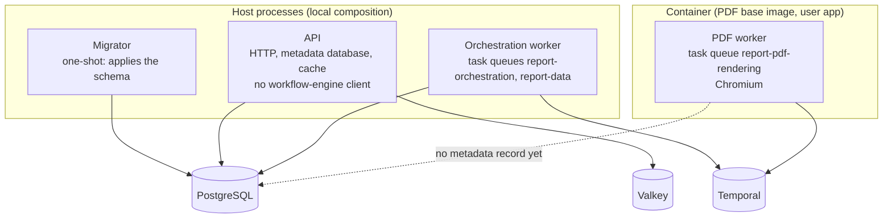

# Process topology

The service runs as three processes. This page explains what each one owns,
what "ready" means for each, and how the consumer registry is declared and
changed while the service runs.



## The three processes

| Process | Project | Owns | Talks to the metadata database | Talks to the workflow engine |
|---------|---------|------|-------------------------------|------------------------------|
| API | `src/ReportService.Api` | The HTTP surface and the consumer registry | Yes — readiness only | **Never** — it holds no workflow-engine client and does not depend on the engine to start or to be ready |
| Orchestration worker | `src/ReportService.Workers.Orchestration` | The task queues `report-orchestration` (workflows and short metadata steps) and `report-data` (data verification and validation) | Yes — readiness only | Yes |
| PDF worker | `src/ReportService.Workers.Pdf` (container image) | The task queue `report-pdf-rendering` (one render at a time) | **Not yet** — it writes no metadata record in this version, so it has no database setting and no database check | Yes |

The one-shot migrator `src/ReportService.Migrations` is not a long-running
process: it applies the database's schema and exits. The API and the
orchestration worker start only after it succeeded, and its failure keeps both
from starting. The database, its role, its journal and the migration rules are
described in [`metadata-database.md`](metadata-database.md).

The two workers share `src/ReportService.ServiceDefaults.Temporal`, the
workflow-engine connection. All three share `src/ReportService.ServiceDefaults`:
validated settings, the JSON body of the health endpoints and the metadata
database's readiness check. The API references only the second, so it carries no
workflow-engine package.

## Configuration is checked before anything starts

Each process validates its settings before it serves a request or reports
ready. A missing or invalid required setting stops the process with a non-zero
exit code and a message such as:

```text
setting 'Temporal:Address': must be host:port
```

The message names the setting and the reason, and **never** the value, so a
secret cannot leak through a configuration error.

| Setting | Process | Required | Meaning |
|---------|---------|----------|---------|
| `Temporal:Address` | both workers | yes | The engine's gRPC endpoint, `host:port` (no scheme, no credential) |
| `Temporal:Namespace` | both workers | yes (default `default`) | The engine namespace |
| `Consumers:File` | API | no | The consumer registry file; without it, `consumers.json` next to the API |
| `ConnectionStrings:reportservice` | API, orchestration worker, migrator | yes | The application role's connection string for the metadata database |
| `Database:ExpectedSchemaVersion` | API, orchestration worker | yes | The schema version the build expects — the highest migration script it embeds |

## Readiness

Every process answers `GET /health`: `200` when it is ready, `503` when it is
not.

### The workers

A worker **connects to the workflow engine first**. It is ready only once the
engine answers on that connection. Until then its health check reports
"connecting", and the process stays alive, retrying every 2 s, doubling to at
most 60 s between attempts.

- Every 5 s it asks the engine whether it is serving.
- If the engine stops answering, the worker is **not ready** from the next
  health request, logs `engine connection lost`, and reconnects with the same
  waits.
- When the engine answers again, the worker logs `engine connection recovered`
  and is **ready again** — the same process, never restarted.

Each worker declares its task queues. It starts polling a queue only once work
is registered on it, with exactly one engine worker per queue. Until then the
health body lists each queue as `no registered work`, and the engine sees no
poller on it. Once work exists, a queue whose engine worker has stopped also
makes the process not ready.

The PDF worker is ready only when **both** its checks pass: Chromium launched
(`chromium`) and the engine answers (`workflow-engine`). They are reported
separately, so the failing one is visible.

A worker's `/health` body:

```json
{
  "status": "Healthy",
  "checks": [
    {
      "name": "workflow-engine",
      "status": "Healthy",
      "durationMs": 4,
      "data": {
        "address": "localhost:7233",
        "namespace": "default",
        "queues": { "report-orchestration": "no registered work", "report-data": "no registered work" }
      }
    },
    { "name": "self", "status": "Healthy", "durationMs": 0, "data": {} }
  ]
}
```

A health body carries only the data keys `address`, `namespace`, `queues`,
`entries`, `fingerprint`, `provider`, `writable`, `readable`, `expected`,
`applied` and `error` — never a description, an exception or a secret value from
configuration.

### The API

The API's `/health` body is the same JSON shape. It does **not** depend on the
workflow engine: the API starts and is ready with the engine stopped. In the
local composition the API waits for PostgreSQL, the migrator's successful exit
and Valkey.

```json
{
  "status": "Healthy",
  "checks": [
    {
      "name": "metadata-database",
      "status": "Healthy",
      "durationMs": 3,
      "data": { "expected": "0001_baseline.sql", "applied": "0001_baseline.sql" }
    }
  ]
}
```

The example shows the database check alone; the body also carries the process's
`storage` check, which reports the storage root's readiness (see
[`object-storage.md`](object-storage.md)).

### The metadata database check

The API and the orchestration worker report `metadata-database`:

- **Healthy** when the database is reachable and the highest applied script is the
  version the build expects;
- **not ready** when it is behind or ahead of that version, with both versions in
  the body;
- **not ready** with `error: unreachable` when the database cannot be reached or
  does not answer within five seconds.

The check is independent of the engine check and of the registry's check: a
database failure never changes either of them, and a registry reload failure
never changes the database's answer. An outage does not stop the process — the
check reports it and recovers on its own when the database returns, and it logs the
change of state once in each direction.

The PDF worker carries the `metadata-database` check: a taken version is published by a record it writes, so the process needs the database and its migrations. It also reads the configured template source, and its start stops naming a missing `TemplateSource:Repository` or `TemplateSource:Branch`.

## The consumer registry

The registry lists the consumers the service knows. It is part of the
service's configuration, kept in its own JSON file, and holds no secret.

```json
{
  "consumers": [
    { "consumerId": "dev-consumer", "displayName": "Development consumer", "active": true },
    { "consumerId": "dev-consumer-disabled", "displayName": "Disabled development consumer", "active": false }
  ]
}
```

The repository ships only this development registry
(`src/ReportService.Api/consumers.json`).

| Property | Rule |
|----------|------|
| `consumerId` | Required; unique within the file (case-sensitive); at most 128 characters of `A-Z a-z 0-9 . _ -` |
| `active` | Required; `true` or `false` |
| `displayName` | Optional; at most 200 characters |
| `authenticationSubject`, `createdAt` | Optional; kept as they are |
| anything else | Ignored, with a warning naming the property and the entry |

An empty list (`"consumers": []`) is a valid registry. What an empty registry
means for requests is decided by the operations that resolve consumers.

### At start

The API validates the registry before it is ready. A missing file, a file that
is not valid JSON, or an invalid entry stops start-up with a message naming
each faulty entry, for example:

```text
setting 'consumers[1]': consumer 'dev-consumer' duplicates consumers[0]
```

### Changing it while the service runs

Edit the file and save it. The API watches the file and applies the change
**without a restart**, normally within a second and always within **5 s**:

- **A valid change** — a consumer added, removed, made inactive or active
  again — replaces the registry in force. The API logs
  `Consumer registry changed: <n> entries, fingerprint <hash>`.
- **An invalid change** is **refused**: the last valid registry stays in force,
  the API stays ready and keeps answering, and it logs a warning naming each
  faulty entry and the reason, never a value:
  `Consumer registry change refused; the last valid registry stays in force: consumers[2]: consumer 'fourth-consumer': active is required`.
  A file saved half-written or not valid JSON is refused the same way; saving
  it again correctly applies it.

A request reads the registry once and uses that version throughout, so a
request already running when a change lands finishes unaffected, and no
request ever sees a partly applied registry.

### Seeing which registry is in force

`GET /health/registry` is a read-only diagnostic. It reports how many entries
the registry in force has and its fingerprint (a SHA-256 of the identities and
active states), and no identity:

```json
{
  "status": "Healthy",
  "checks": [
    { "name": "consumer-registry", "status": "Healthy", "durationMs": 0,
      "data": { "entries": 2, "fingerprint": "096813b17ac899030b47e608f9a3259867408f9de9cff3af769723909e45c025" } }
  ]
}
```

A change that takes effect moves the fingerprint; a refused change leaves it
as it was. The diagnostic is always `Healthy`: the registry is configuration,
not a dependency.

In the local composition, the API uses its own `consumers.json`. To point it at
another file, start the composition with
`dotnet run --project src/ReportService.AppHost -- --Consumers:File=<path>`.
